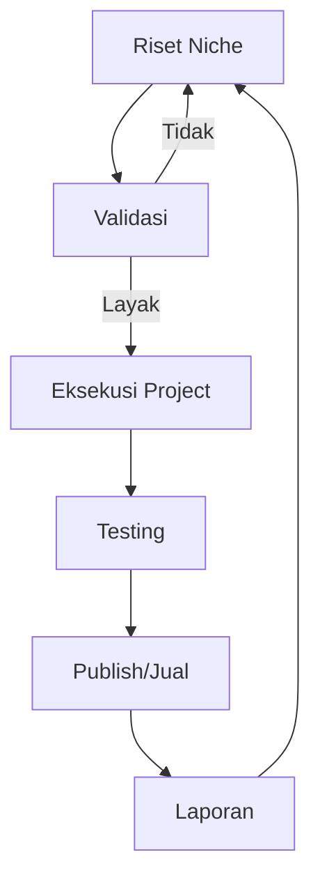

# Agent_Agil Quick Start Guide

## 🚀 Setup

```bash
# Clone repo
git clone https://github.com/username/Agent_Agil.git
cd Agent_Agil

# Setup environment
python -m venv venv
source venv/bin/activate  # Linux/Mac
# venv\Scripts\activate  # Windows

# Install
pip install -e .
```

## 🛠️ Configure

Edit `src/agent_agil/config/.env`:

```ini
# Wallet (read-only)
PK_WALLET="your_private_key_here"

# Spending limits
DAILY_SPEND_LIMIT="0"
PER_TRANSACTION_LIMIT="0"
```

## ▶️ Run

```bash
# Show agent state
agent-agil state

# List personalities
agent-agil personalities

# Switch personality
agent-agil switch freelancer

# Research a niche
agent-agil research "freelance writing"

# Check wallet
agent-agil wallet

# List skills
agent-agil skills
```

## 📊 Workflow



## 🤖 Skills

- `market-research`: Validasi niche
- `trend-scraping`: Analisis tren sosial media
- `content-creation`: Buat konten
- `freelance-proposal`: Buat proposal freelance
- `cost-accounting`: Lacak biaya & revenue
- `risk-assessment`: Evaluasi risiko

## 📜 Lisensi

MIT License. Lihat `LICENSE` untuk detail.