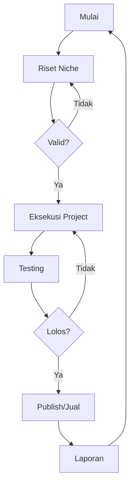

# Agent_Agil (Money-Hunter) - Standalone CLI Agent

```
░█▀▀░█▀█░█▀█░█▀▀░█▀▄░█▀█░█▀▀░█▀▀
░█░░░█▀█░█░█░█▀▀░█▀▄░█░█░█▀▀░▀▀█
░▀▀▀░▀░▀░▀░▀░▀▀▀░▀░▀░▀▀▀░▀▀▀░▀▀▀
```

**Agent_Agil** adalah framework agent otonom yang dirancang untuk mencari peluang penghasilan di berbagai niche, memvalidasi ide, dan mengeksekusi project secara mandiri — **tanpa bergantung pada Hermes atau platform lain**.

## 🚀 Fitur Utama

- **Personality Switching**: Ubah mode kerja sesuai niche (misal: `trader_analyst`, `content_creator`, `freelancer`)
- **Wallet Integration**: Baca saldo wallet crypto (read-only, aman)
- **Skill System**: Modular skills untuk riset, eksekusi, dan pelaporan
- **Workflow Otomatis**: Ikuti alur riset → validasi → eksekusi → laporan
- **CLI Mandiri**: Jalankan agent dari terminal, push ke GitHub, deploy sendiri
- **Open Source**: 100% Python, tanpa `.exe`, siap dimodifikasi

## 📁 Struktur Proyek

```
Agent_Agil/
├── src/agent_agil/
│   ├── core/          # Core agent logic
│   ├── config/        # Konfigurasi (SOUL.md, AGENTS.md, dll)
│   ├── skills/        # Skill modular
│   ├── runtime/       # Runtime system
│   └── cli/           # CLI commands
├── tests/            # Unit tests
├── docs/             # Dokumentasi
├── scripts/          # Utility scripts
├── logs/             # Log aktivitas
├── config/           # Config files (symlink ke src/config)
└── pyproject.toml    # Build system
```

## 🛠️ Instalasi

```bash
# Clone repo
git clone https://github.com/username/Agent_Agil.git
cd Agent_Agil

# Setup environment
python -m venv venv
source venv/bin/activate  # Linux/Mac
# venv\Scripts\activate  # Windows

# Install
pip install -e .
```

## ▶️ Penggunaan

```bash
# Jalankan agent
agent-agil

# Ganti personality
agent-agil --personality content_creator

# Riset niche
agent-agil research --niche "freelance writing"

# Lihat saldo wallet
agent-agil wallet --balance
```

## 📜 Konfigurasi

Edit file di `config/`:
- `SOUL.md`: Identitas inti agent
- `AGENTS.md`: Tools & batasan
- `config.yaml`: Personality modes
- `MEMORY_SEED.json`: Limit & preferensi
- `.env`: Wallet & API keys

## 🤖 Skill System

Skill yang tersedia:
- `market-research`: Validasi niche
- `trend-scraping`: Analisis tren sosial media
- `content-creation`: Buat konten
- `freelance-proposal`: Buat proposal freelance
- ... *(lihat `SKILLS.md` untuk daftar lengkap)*

## 📊 Workflow



## 📜 Lisensi

MIT License. Lihat `LICENSE` untuk detail.

## 📬 Kontak

Farhan Agil - [@farhanagil](https://github.com/farhanagil)

---
**Agent_Agil: Cari uang, belajar, dan berkembang — secara otonom.**

## English overview

**Agent_Agil (Money-Hunter)** is a standalone command-line agent framework written in Python. It helps its user look for income opportunities in different niches, validate ideas, and run projects step by step from the terminal, without depending on Hermes or another platform. The agent is driven entirely through the `agent-agil` CLI, with its configuration in `config/` and its code in `src/agent_agil/`.

## Features
- **CLI-first agent** — the `agent-agil` command (defined in `pyproject.toml`, implemented in `src/agent_agil/cli/main.py`) can research a niche, list and run skills, switch personalities, show the current state and configuration, and check a wallet balance.
- **Personality switching** — change the agent's working mode with `agent-agil switch <name>` or the `--personality` option.
- **Modular skills** — skills are listed with `agent-agil skills` and run with `agent-agil skill <name>`; the `research` command runs the market-research skill for a given niche.
- **Wallet check** — `agent-agil wallet` shows the configured wallet balance and the daily and per-transaction spend limits.
- **Config-driven behaviour** — identity, personality, and limits are set in `config/` (`SOUL.md`, `AGENTS.md`, `config.yaml`, `MEMORY_SEED.json`, and `.env`).

## How to run
Requires Python 3.11 or later (`pyproject.toml`).

```bash
pip install -e .
agent-agil
```

Run `agent-agil --help` to list the available commands, or `agent-agil` on its own to see a preview of the system prompt.

---
Built by Farhan (cryCPowr) — Kaggle: https://www.kaggle.com/farhanagilalmunzid · YouTube (CEY Studio): https://www.youtube.com/@CEYStudioID · X: https://x.com/0x_taiga
