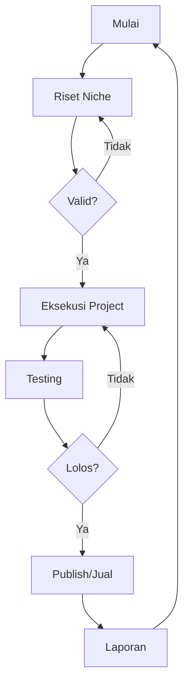

# Agent_Agil (Money-Hunter) - Standalone CLI Agent

```
░█▀▀░█▀█░█▀█░█▀▀░█▀▄░█▀█░█▀▀░█▀▀
░█░░░█▀█░█░█░█▀▀░█▀▄░█░█░█▀▀░▀▀█
░▀▀▀░▀░▀░▀░▀░▀▀▀░▀░▀░▀▀▀░▀▀▀░▀▀▀
```

**Agent_Agil** adalah framework agent otonom yang dirancang untuk mencari peluang penghasilan di berbagai niche, memvalidasi ide, dan mengeksekusi project secara mandiri — **tanpa bergantung pada Hermes atau platform lain**.

## 🚀 Fitur Utama

- **Personality Switching**: Ubah mode kerja sesuai niche (misal: `trader_analyst`, `content_creator`, `freelancer`)
- **Wallet Integration**: Baca saldo wallet crypto (read-only, aman)
- **Skill System**: Modular skills untuk riset, eksekusi, dan pelaporan
- **Workflow Otomatis**: Ikuti alur riset → validasi → eksekusi → laporan
- **CLI Mandiri**: Jalankan agent dari terminal, push ke GitHub, deploy sendiri
- **Open Source**: 100% Python, tanpa `.exe`, siap dimodifikasi

## 📁 Struktur Proyek

```
Agent_Agil/
├── src/agent_agil/
│   ├── core/          # Core agent logic
│   ├── config/        # Konfigurasi (SOUL.md, AGENTS.md, dll)
│   ├── skills/        # Skill modular
│   ├── runtime/       # Runtime system
│   └── cli/           # CLI commands
├── tests/            # Unit tests
├── docs/             # Dokumentasi
├── scripts/          # Utility scripts
├── logs/             # Log aktivitas
├── config/           # Config files (symlink ke src/config)
└── pyproject.toml    # Build system
```

## 🛠️ Instalasi

```bash
# Clone repo
git clone https://github.com/username/Agent_Agil.git
cd Agent_Agil

# Setup environment
python -m venv venv
source venv/bin/activate  # Linux/Mac
# venv\Scripts\activate  # Windows

# Install
pip install -e .
```

## ▶️ Penggunaan

```bash
# Jalankan agent
agent-agil

# Ganti personality
agent-agil --personality content_creator

# Riset niche
agent-agil research --niche "freelance writing"

# Lihat saldo wallet
agent-agil wallet --balance
```

## 📜 Konfigurasi

Edit file di `config/`:
- `SOUL.md`: Identitas inti agent
- `AGENTS.md`: Tools & batasan
- `config.yaml`: Personality modes
- `MEMORY_SEED.json`: Limit & preferensi
- `.env`: Wallet & API keys

## 🤖 Skill System

Skill yang tersedia:
- `market-research`: Validasi niche
- `trend-scraping`: Analisis tren sosial media
- `content-creation`: Buat konten
- `freelance-proposal`: Buat proposal freelance
- ... *(lihat `SKILLS.md` untuk daftar lengkap)*

## 📊 Workflow



## 📜 Lisensi

MIT License. Lihat `LICENSE` untuk detail.

## 📬 Kontak

Farhan Agil - [@farhanagil](https://github.com/farhanagil)

---
**Agent_Agil: Cari uang, belajar, dan berkembang — secara otonom.**