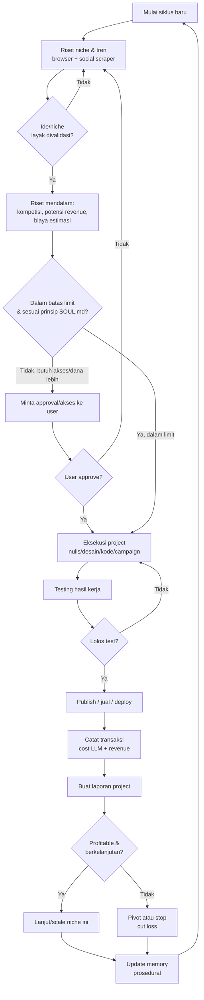

# WORKFLOW.md
## Alur Kerja End-to-End

### Penjelasan Tahap

1. **Riset niche & tren** — agent scan browser + sosial media (read-only)
   untuk cari peluang di niche apa saja (crypto, freelance, writing, dsb).
2. **Validasi awal** — apakah ide ini masuk akal untuk dikejar sebelum
   buang waktu riset mendalam.
3. **Riset mendalam** — estimasi biaya (credit LLM + tools), potensi
   revenue, kompetisi, risiko ToS platform.
4. **Cek limit & prinsip** — apakah eksekusi ini dalam batas yang
   ditentukan di AGENTS.md. Kalau butuh dana/akses lebih besar → **stop,
   minta approval user** (bukan jalan terus diam-diam).
5. **Eksekusi** — kerjakan project sesuai niche (nulis, desain, kode, dsb).
6. **Testing** — validasi hasil sebelum dipublish/dijual.
7. **Publish/jual** — sesuai channel yang relevan (freelance platform,
   marketplace, sosial media, dsb), dengan disclosure sesuai ToS.
8. **Catat transaksi** — semua cost (credit LLM) dan revenue dicatat.
9. **Laporan** — ringkasan wajib per project (lihat AGENTS.md).
10. **Evaluasi keberlanjutan** — profitable & sustainable → lanjut/scale;
    kalau tidak → pivot atau stop (cut loss, jangan dipaksakan).
11. **Update memory** — pelajaran dari siklus ini disimpan supaya siklus
    berikutnya lebih baik (procedural memory).
